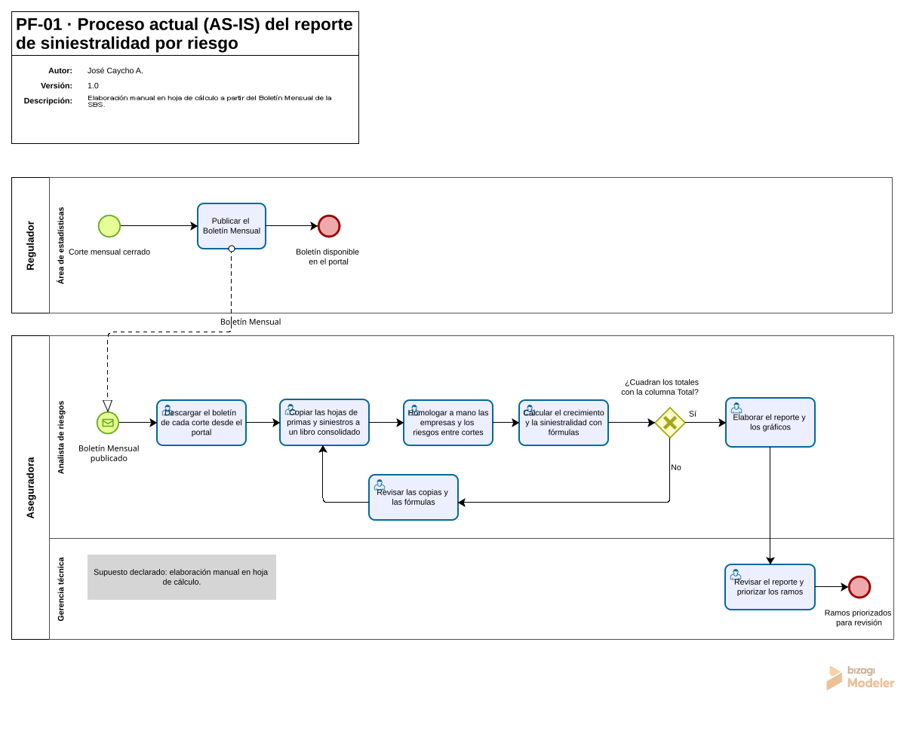
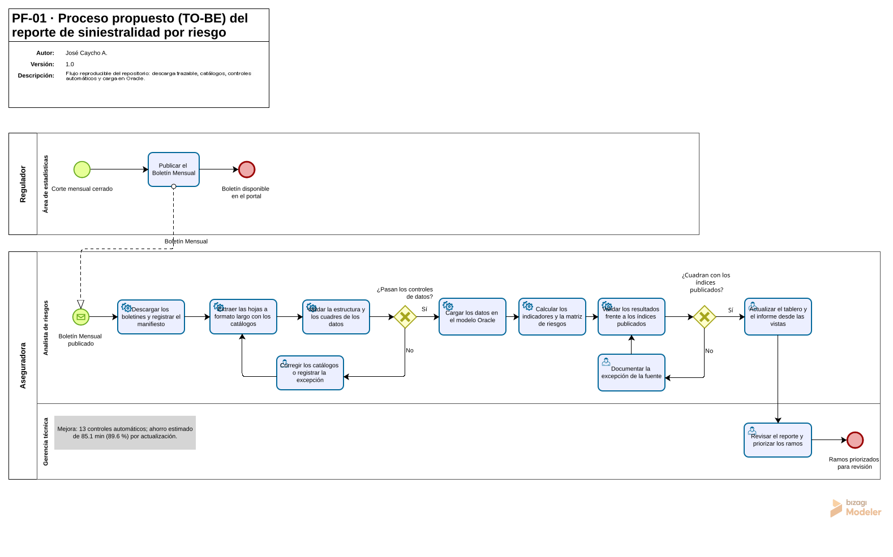

# PF-01 · Producción y siniestralidad por riesgo del mercado asegurador peruano, 2019-2026

`Portafolio · PF-01` · José Caycho A. · octubre de 2026

> En agosto de 2026, la siniestralidad directa del sistema asegurador peruano subió a 48.9 %, 7.5 puntos porcentuales (p. p.) más que un año antes (Superintendencia de Banca, Seguros y AFP [SBS], s. f.-a). Dos riesgos explican el alza: Vida Individual de Largo Plazo aporta 5.1 p. p. y su salto coincide con el cambio contable de marzo de 2026 que incorpora «otras obligaciones» de los seguros de vida con ahorro (SBS, s. f.-d, 2026); Incendio aporta 2.9 p. p. Sin ambos, el índice del resto del sistema pasa de 44.7 % a 45.0 %, con Renta Particular, que también sube en marzo de 2026, incluida. Este repositorio reproduce el análisis completo, de la descarga de los boletines al tablero, y valida cada cifra contra la fuente.

## Problema

¿Qué riesgos del sistema asegurador peruano crecen en primas con una siniestralidad mayor que la del conjunto, y cómo evolucionó el índice del sistema entre 2019 y 2026? Es una pregunta de monitoreo del mercado que un analista responde cada mes con los boletines de la SBS (s. f.-a). El proyecto la contesta con un flujo reproducible que valida sus propias cifras y separa, en una matriz de cuadrantes, los riesgos que crecen con siniestralidad contenida de los que crecen por encima del corte del sistema. El alcance describe cifras agregadas por riesgo; excluye juicios sobre la gestión de las empresas y cualquier dato personal ([`docs/01_acta.md`](docs/01_acta.md), sección 4).

## Datos

| Fuente | Documento o serie | Fecha de corte | Condiciones de uso |
|---|---|---|---|
| SBS | Boletín mensual (S-367), 9 cortes | Diciembre de 2019 a 2025 y agosto de 2025 y 2026 | No declaradas (ver nota) |
| SBS | S-401 · Primas de seguros netas, cedidas y retenidas según riesgos | 2026-08-31 | No declaradas |
| SBS | S-402 · Siniestros de primas de seguros netas, cedidas y retenidas según riesgos | 2026-08-31 | No declaradas |
| SBS | S-403 · Índice de siniestralidad directa y retenida según riesgos | 2026-08-31 | No declaradas |
| SBS | S-401 y S-402 mensuales, 40 cuadros | Fin de cada mes, de enero de 2025 a agosto de 2026 | No declaradas |

Los datos se descargaron el 11 de octubre de 2026 con `uv run python scripts/descargar_sbs.py`, y los cuadros mensuales, el 27 de octubre de 2026 con `uv run python scripts/descargar_mensual.py` (manifiesto en [`data/raw/mensual/manifest.csv`](data/raw/mensual/manifest.csv)); los archivos originales no se versionan y [`data/raw/manifest.csv`](data/raw/manifest.csv) registra la URL, la fecha de descarga y la huella SHA-256 de cada uno. Sobre las condiciones de uso: el portal de la SBS indica «Todos los derechos reservados» y su página de datos abiertos no declara una licencia, así que el proyecto publica solo agregados propios con su cita y no redistribuye los archivos originales (detalle en [`data/README.md`](data/README.md)). Este proyecto no usa datos personales.

## Método

El flujo de datos tiene tres etapas ETL (extracción, transformación y carga) y una de consumo (figura 1). El detalle de cada etapa, las decisiones de diseño y el modelo relacional están en [`docs/04_arquitectura.md`](docs/04_arquitectura.md).

1. Extracción: `scripts/descargar_sbs.py` descarga los boletines por HTTPS, los guarda sin modificar en `data/raw/` y los contrasta con el manifiesto.
2. Transformación: `src/pf_01_siniestralidad_sbs/extraccion.py` lleva las hojas a formato largo en `data/interim/`; los catálogos resuelven empresas, riesgos, cortes y excepciones, y `scripts/validar_datos.py` aplica los controles de cuadre y de estructura.
3. Carga: `scripts/cargar_oracle.py` puebla en Oracle las 3 tablas `stg_`, las 7 dimensiones `dim_`, las 3 tablas de hechos `fct_` y las 12 vistas `vw_` de `sql/oracle/`.
4. Consumo: `scripts/exportar_indicadores.py` escribe los CSV versionados de `data/processed/` que leen el informe, las figuras y el tablero Power BI. `scripts/descargar_mensual.py` agrega la serie mensual por riesgo (`data/processed/serie_mensual_riesgos.csv`) y `scripts/figura_contribucion.py` descompone el cambio del índice del sistema en la contribución de cada riesgo.

**Figura 1**

*Arquitectura del flujo de datos de PF-01*


*Nota.* Elaboración propia.

El proceso que el proyecto reemplaza y el que propone están modelados en BPMN 2.0 con Bizagi Modeler 4.3 (figuras 2 y 3). El AS-IS es un supuesto declarado, la elaboración manual del reporte en hoja de cálculo, y no describe la práctica de una empresa en particular. En el TO-BE, seis tareas de servicio, que son los scripts del repositorio, reemplazan la descarga, la copia, la homologación, el cálculo y el cuadre manuales. La tabla 1 compara el tiempo de producir el reporte, desde la descarga de los boletines hasta los indicadores validados: el AS-IS es una estimación del autor y el TO-BE, una medición del flujo, que reprocesa los 9 cortes. Incorporar un corte nuevo exige hoy editar la lista de cortes en `src/pf_01_siniestralidad_sbs/fuentes.py`. Los diagramas conservan el formato estándar de Bizagi (D-PF01-20); el modelo editable, un archivo BPMN por diagrama y la documentación en PDF están en [`docs/procesos/`](docs/procesos/).

**Figura 2**

*Proceso actual (AS-IS) del reporte de siniestralidad por riesgo*



*Nota.* Elaboración propia con base en un supuesto declarado: elaboración manual en hoja de cálculo.

**Tabla 1**

*Tiempo del reporte de siniestralidad, AS-IS estimado frente a TO-BE medido, por actividad*

| Actividad | AS-IS (min) | TO-BE (min) | Ahorro (min) | Ahorro (%) |
|---|---:|---:|---:|---:|
| Obtención | 6.0 | 0.7 | 5.3 | 88.5 % |
| Consolidación | 46.0 | 1.5 | 44.5 | 96.7 % |
| Cálculo | 15.0 | 0.8 | 14.2 | 94.5 % |
| Control | 28.0 | 6.8 | 21.2 | 75.6 % |
| **Total** | **95.0** | **9.9** | **85.1** | **89.6 %** |

*Nota.* AS-IS: estimación del autor con las cantidades del proyecto y tiempos unitarios declarados. TO-BE: mediana de tres corridas medidas del flujo del repositorio el 2026-10-19, que reprocesa los 9 cortes e incluye la pausa de 2 s entre descargas, más 6 min estimados de lectura de las dos notas de validación. Equipo: Intel Core i7-1355U, 15.7 GB de RAM, Windows 11 Pro y Oracle Database 23ai Free 23.6. Las cifras se redondean a un decimal, por lo que la suma de las filas puede diferir del total. Detalle por tarea en [`PF-01_tiempos.csv`](docs/procesos/PF-01_tiempos.csv); versión con la identidad visual en [SVG](docs/procesos/PF-01_tiempos.svg) y [PDF](docs/procesos/PF-01_tiempos.pdf), generada con `scripts/figura_tiempos.py`. Elaboración propia.

**Figura 3**

*Proceso propuesto (TO-BE) del reporte de siniestralidad por riesgo*



*Nota.* Elaboración propia. Las tareas de servicio son los scripts del repositorio; el ahorro de la anotación proviene de la tabla 1.

## Gestión del proyecto

| Elemento | Archivo |
|---|---|
| Acta y objetivos SMART | [`docs/01_acta.md`](docs/01_acta.md) |
| EDT y Gantt de la línea base v1.0 (vista resumida, congelada al aprobar el plan) | [`docs/02_edt_gantt.md`](docs/02_edt_gantt.md) |
| Gantt de Microsoft Project con el avance real (PDF, se actualiza en cada registro de avance) | [`gestion/cronograma/PF-01_seguimiento.pdf`](gestion/cronograma/PF-01_seguimiento.pdf) |
| Gantt de la línea base v1.0 en Microsoft Project (PDF, fijado el 2026-10-11) | [`gestion/cronograma/PF-01_linea_base.pdf`](gestion/cronograma/PF-01_linea_base.pdf) |
| Cronograma de Microsoft Project (`.mpp` y XML) | [`gestion/cronograma/`](gestion/cronograma/) |
| Arquitectura del flujo de datos y modelo relacional | [`docs/04_arquitectura.md`](docs/04_arquitectura.md) |
| Procesos AS-IS y TO-BE en Bizagi (`.bpm`, BPMN 2.0, SVG y PDF) y tabla de tiempos (CSV, SVG y PDF) | [`docs/procesos/`](docs/procesos/) |
| Cierre, desvíos y lecciones | [`docs/05_cierre_lecciones.md`](docs/05_cierre_lecciones.md) |

## Resultados

La siniestralidad directa del sistema pasó de 53.0 % en diciembre de 2019 a un máximo de 59.3 % en diciembre de 2021, bajó en los cuatro cortes anuales siguientes hasta 39.4 % en diciembre de 2025 y repuntó a 48.9 % en agosto de 2026, 7.5 p. p. por encima de agosto de 2025; la retenida cerró en 45.7 % (figura 4). Las primas netas acumuladas del corte llegaron a 16 784.7 millones de soles, 9.0 % más que un año antes (SBS, s. f.-a, s. f.-b, s. f.-c, s. f.-d).

**Figura 4**

*Índice de siniestralidad del sistema asegurador peruano por corte, 2019-2026*


*Nota.* Elaboración propia con datos de SBS (s. f.-a, s. f.-b, s. f.-c, s. f.-d). Figura y tabla de la serie generadas con `uv run python scripts/figura_serie.py`; los puntos huecos marcan los cortes de agosto (8 meses acumulados).

El alza no es generalizada (figura 5 y tabla 2). De los +7.54 p. p. de la directa, Vida Individual de Largo Plazo aporta +5.12: sus siniestros mensuales promediaron 9.5 millones de soles hasta febrero de 2026 y saltaron a 310.6 millones en marzo, el mes desde el cual rige la Resolución SBS N.º 00085-2026, que estandariza el tratamiento contable de los rescates y vencimientos de los seguros de vida con componente de ahorro (SBS, 2026); desde ese mes, el cuadro de siniestros de la SBS incluye «otras obligaciones» (SBS, s. f.-d). Incendio aporta +2.91, con siniestros elevados en marzo, abril, julio y agosto de 2026, cedidos en un 89.1 % en reaseguro. Los otros 46 riesgos suman −0.49; entre ellos, Renta Particular (+1.60), otro seguro con componente de ahorro, también sube en marzo de 2026, y ese efecto no se aisló. El detalle, con la serie mensual, está en la sección 4 del informe.

**Figura 5**

*Contribución de los riesgos al cambio de la siniestralidad directa del sistema, agosto de 2025 a agosto de 2026*


*Nota.* Elaboración propia con datos de SBS (s. f.-a, s. f.-c, s. f.-d). Figura generada con `uv run python scripts/figura_contribucion.py`; las contribuciones suman el cambio del sistema.

**Tabla 2**

*Contribución de los riesgos al cambio de la siniestralidad del sistema, agosto de 2025 a agosto de 2026*

| Riesgo | Directa, agosto de 2025 (%) | Directa, agosto de 2026 (%) | Contribución a la directa (p. p.) | Contribución a la retenida (p. p.) |
|---|---:|---:|---:|---:|
| Vida Individual de Largo Plazo | 4.4 | 45.0 | +5.12 | +6.15 |
| Incendio | 76.7 | 224.0 | +2.91 | +0.43 |
| Renta Particular | 20.6 | 27.8 | +1.60 | +1.82 |
| Seguro de Bancos (BBB) | −479.5 | 69.0 | +0.37 | +0.01 |
| Resto (42 riesgos) |  |  | −1.15 | −1.80 |
| Renta de Jubilados | 1 300.7 | 1 853.2 | −0.48 | −0.71 |
| Seguro Complementario de Trabajo de Riesgo | 72.4 | 56.2 | −0.83 | −0.40 |
| **Sistema** | **41.4** | **48.9** | **+7.54** | **+5.50** |

*Nota.* Elaboración propia con datos de SBS (s. f.-a, s. f.-c, s. f.-d). Riesgos con mayor contribución al alza y a la baja de la directa; el resto se agrupa en una fila. Los índices propios de las rentas y de Seguro de Bancos (BBB) en agosto de 2025 no son comparables con el resto (informe, tabla 2). Tabla generada con `uv run python scripts/figura_contribucion.py --tabla`.

De los 48 riesgos del corte, 35 quedan clasificados en la matriz de cuadrantes: 9 crecen con una siniestralidad directa mayor que el corte de 44.0 % y concentran 5 305.3 millones de soles de primas, con Vida Individual de Largo Plazo, Asistencia Médica y Vehículos a la cabeza (83.7 % del cuadrante). La figura 6 muestra la página «Matriz de riesgos» del tablero Power BI, cuya segmentación «Medida» alterna entre la siniestralidad directa y la retenida ([`dashboards/powerbi/README.md`](dashboards/powerbi/README.md)). Las tablas completas, la lectura con la medida retenida y las conclusiones están en el informe de resultados ([`reports/informe.md`](reports/informe.md)).

**Figura 6**

*Matriz de riesgos con la siniestralidad directa, agosto de 2026*


*Nota.* Elaboración propia con datos de SBS (s. f.-a). Los ejes se recortan en 60 % de variación y 100 % de siniestralidad (D-PF01-13): 3 de los 35 riesgos clasificados quedan fuera de escala y no se dibujan, aunque cuentan en las tablas.

## Cómo reproducir

Sin Oracle, con [uv](https://docs.astral.sh/uv/) instalado (verificado desde un clon limpio el 27 de octubre de 2026: 154 pruebas superadas y 51 omitidas en 3 s):

```bash
git clone https://github.com/josecaychoa/pf-01-siniestralidad-sbs.git
cd pf-01-siniestralidad-sbs
uv sync --locked
uv run pytest
```

Las 51 pruebas omitidas son las de integración, que requieren la base Oracle o los archivos de `data/raw/`. El flujo completo las habilita y requiere Docker:

```bash
cp .env.example .env            # completar las variables locales
docker compose up -d
uv run python scripts/descargar_sbs.py
uv run python scripts/validar_datos.py
uv run python scripts/descargar_mensual.py
uv run --env-file .env python scripts/cargar_oracle.py --base contenedor
uv run --env-file .env python scripts/exportar_indicadores.py --base contenedor
uv run --env-file .env python scripts/validar_resultados.py --base contenedor
uv run --env-file .env pytest
```

Las pruebas de Oracle leen la conexión de las variables de entorno, así que `pytest` necesita `--env-file .env`; sin esa opción, uv no carga el archivo y las pruebas se omiten. La base debe ser Oracle Database 23ai o posterior: el DDL usa `BOOLEAN` y `CREATE TABLE IF NOT EXISTS`, que no existen en 19c.

Los conteos de filas y los cuadres esperados tras la carga están en el diccionario de datos ([`docs/03_diccionario_datos.md`](docs/03_diccionario_datos.md), sección 5). El tablero no necesita Oracle: lee los CSV versionados de `data/processed/` y se abre con Power BI Desktop en Windows según la guía de [`dashboards/powerbi/README.md`](dashboards/powerbi/README.md).

## Cómo se construyó

El proyecto se desarrolló con asistencia de inteligencia artificial: Claude Code (Anthropic) escribió la mayor parte del código, las pruebas y los commits, y abrió cada pull request en borrador; Claude, en un chat aparte, ayudó a planificar y revisó cada PR. José Caycho A. definió el problema, aprobó el plan y cada cambio de alcance, validó los resultados y fusionó los PR. La rama `main` exige que la integración continua (ruff y pytest) pase y un estado de revisión (`revision/claude`) que se publica solo después de esa revisión. Ninguna cifra depende del criterio de la IA: las pruebas automáticas la contrastan con la fuente publicada por la SBS.

## Estructura

```text
├── assets/                        # estilo matplotlib y tema de Power BI de la marca
├── dashboards/powerbi/            # tablero en formato PBIP (informe PBIR y modelo TMDL)
├── data/                          # raw (inmutable, no versionada), interim y processed (CSV versionados)
├── docs/                          # acta · EDT y Gantt · diccionario · arquitectura · diagramas · modelo · procesos
├── gestion/cronograma/            # cronograma de Microsoft Project (.mpp, XML y PDF)
├── notebooks/                     # exploración de las vistas vw_
├── reports/                       # informe de resultados, notas de validación y figuras
├── scripts/                       # descarga, validación, carga, exportación, figuras y lint de texto
├── sql/oracle/                    # scripts idempotentes: DDL · vistas · carga (prefijos stg_, dim_, fct_, vw_)
├── src/pf_01_siniestralidad_sbs/  # paquete Python del flujo
└── tests/                         # 205 pruebas (154 se ejecutan sin Oracle ni datos descargados)
```

## Limitaciones

- Desde la información de marzo de 2026, los siniestros de la SBS incluyen «otras obligaciones» por la Resolución SBS N.º 00085-2026: el corte de agosto de 2026 no es comparable con los anteriores en Vida Individual de Largo Plazo, y probablemente tampoco en Renta Particular. No se pudo leer el Anexo de la resolución; la atribución es una inferencia que se apoya en el mes del quiebre, en el título y la nota del cuadro de la SBS y en el considerando de la norma.
- Los cortes de agosto acumulan 8 meses y los de diciembre, 12; el índice no está anualizado, así que las comparaciones interanuales válidas son entre cortes del mismo mes.
- La matriz usa un solo corte (agosto de 2026). Para otro corte hay que regenerar los CSV con `uv run python scripts/exportar_indicadores.py`.
- 5 riesgos previsionales y 8 riesgos bajo el umbral de materialidad quedan fuera de la clasificación por cuadrante; en diciembre de 2020, 5 celdas del índice publicado difieren del calculado porque la fuente usó el Total simple (D-PF01-18).
- Los índices describen montos agregados por riesgo: no miden rentabilidad técnica ni suficiencia de primas.
- Este análisis tiene fines demostrativos y no constituye asesoría regulatoria, actuarial ni financiera.

## Referencias

Superintendencia de Banca, Seguros y AFP. (s. f.-a). *Boletín mensual* [Conjunto de datos]. Recuperado el 11 de octubre de 2026, de https://www.sbs.gob.pe/app/stats_net/stats/EstadisticaSistemaFinancieroResultados.aspx?c=S-367

Superintendencia de Banca, Seguros y AFP. (s. f.-b). *Índice de siniestralidad directa y retenida según riesgos* [Conjunto de datos]. Recuperado el 11 de octubre de 2026, de https://www.sbs.gob.pe/app/stats_net/stats/EstadisticaSistemaFinancieroResultados.aspx?c=S-403

Superintendencia de Banca, Seguros y AFP. (s. f.-c). *Primas de seguros netas, cedidas y retenidas según riesgos* [Conjunto de datos]. Recuperado el 11 y el 27 de octubre de 2026, de https://www.sbs.gob.pe/app/stats_net/stats/EstadisticaSistemaFinancieroResultados.aspx?c=S-401

Superintendencia de Banca, Seguros y AFP. (s. f.-d). *Siniestros de primas de seguros netas, cedidas y retenidas según riesgos* [Conjunto de datos]. Recuperado el 11 y el 27 de octubre de 2026, de https://www.sbs.gob.pe/app/stats_net/stats/EstadisticaSistemaFinancieroResultados.aspx?c=S-402

Superintendencia de Banca, Seguros y AFP. (2026). *Resolución S.B.S. N.º 00085-2026: Modifica el Plan de Cuentas para las Empresas del Sistema Asegurador*. https://intranet2.sbs.gob.pe/dv_int_cn/2551/v1.0/Adjuntos/R.%2000085-2026.pdf

## Licencia

Código bajo licencia MIT. Los datos conservan las condiciones de uso de su fuente original.

## Autor

José Caycho A. · Business Analyst Senior · Procesos · Datos
linkedin.com/in/jcaychoasin · github.com/josecaychoa
