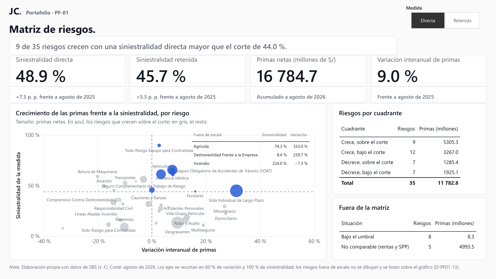
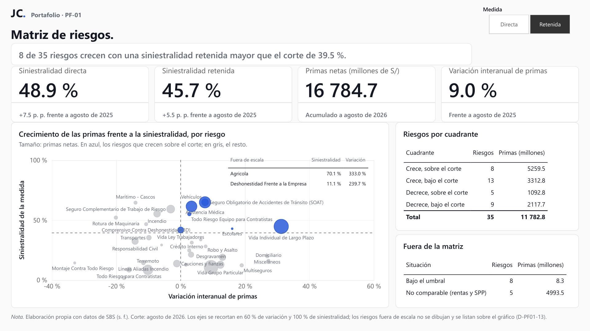

# Tablero Power BI · PF-01

`Portafolio · PF-01` · Paquete 4.1 (issue #10) · Power BI Desktop 2.159 (octubre de 2026)

El tablero tiene una página, «Matriz de riesgos», que ubica cada riesgo comparable según la variación interanual de sus primas netas y su índice de siniestralidad en el corte de agosto de 2026, con datos del Boletín mensual de la Superintendencia de Banca, Seguros y AFP (SBS, s. f.). La segmentación «Medida» cambia la siniestralidad directa por la retenida. Con la directa, 9 de los 35 riesgos clasificados crecen con una siniestralidad mayor que el corte de 44.0 % (figura 1); con la retenida, son 8 de 35 y el corte es 39.5 % (figura 2). La serie 2019-2026 y la participación por empresa quedaron en el prototipo y no en el PBIP (decisión D-PF01-22). Cada indicador tiene su ficha (IA-PF01-01 a IA-PF01-07) en la sección 6.1 del [acta](../../docs/01_acta.md).

## Contenido

| Archivo o carpeta | Contenido |
|---|---|
| `PF-01_tablero.pbip` | Abre el informe y su modelo semántico en Power BI Desktop |
| `PF-01_tablero.Report/` | Informe en formato PBIR: la página, sus 12 objetos visuales y el tema de la marca registrado en `StaticResources/RegisteredResources/` (copia de `assets/jc-powerbi-tema.json`) |
| `PF-01_tablero.SemanticModel/` | Modelo semántico en TMDL: las tablas de los tres CSV, las tablas calculadas `Medida` y `Cuadrante`, el parámetro `RutaDatos` y las medidas DAX |

El modelo lee `matriz_riesgos.csv`, `indicadores_riesgo.csv` y `crecimiento_riesgos.csv` de `data/processed/`, que están versionados (D-PF01-23); no hace falta Oracle ni ejecutar el flujo de datos para abrir el tablero. `.gitignore` excluye la configuración local (`.pbi/localSettings.json`) y la caché del modelo (`.pbi/cache.abf`).

## Cómo abrirlo

1. Clonar el repositorio en una ruta local corta, por ejemplo `C:\Portafolio\pf-01-siniestralidad-sbs\`. Power BI Desktop no guarda un PBIP directamente en OneDrive ni en SharePoint, y Windows limita a 260 caracteres la ruta de cada archivo del proyecto (Microsoft, s. f.-a).
2. Abrir `dashboards\powerbi\PF-01_tablero.pbip` con Power BI Desktop en Windows.
3. Si el clon está en otra carpeta, abrir el Editor de Power Query (Inicio > Transformar datos) y, en Inicio > Administrar parámetros, cambiar el valor actual de `RutaDatos` por la ruta de `data\processed\` del clon, con la barra invertida final (Microsoft, s. f.-b). Después, Cerrar y aplicar.
4. Si aparece el aviso de objetos calculados sin actualizar, seleccionar Actualizar.

## Capturas

**Figura 1**

*Matriz de riesgos con la siniestralidad directa, agosto de 2026*

*Nota.* Elaboración propia con datos de SBS (s. f.). Página exportada a PDF desde Power BI Desktop y convertida a PNG de 1920 × 1080 píxeles. Los ejes se recortan en 60 % de variación y 100 % de siniestralidad (D-PF01-13): con la directa, 3 de los 35 riesgos clasificados (Agricola, Deshonestidad Frente a la Empresa e Incendio) quedan fuera de escala; no se dibujan, se listan sobre el gráfico y cuentan en las tablas. Cada tarjeta muestra el cambio o el período que compara: +7.5 p. p. en la directa y +5.5 p. p. en la retenida frente a agosto de 2025. Primas en millones de soles.

**Figura 2**

*Matriz de riesgos con la siniestralidad retenida, agosto de 2026*

*Nota.* Elaboración propia con datos de SBS (s. f.). Misma página que la figura 1, con la medida Retenida. Con la retenida, 2 de los 35 riesgos clasificados quedan fuera de escala (Agricola y Deshonestidad Frente a la Empresa); Incendio sí se dibuja, con 55.4 %. Primas en millones de soles.

## Cuadre

Las cifras del tablero coinciden con `reports/validacion_resultados.md`: siniestralidad del sistema de 48.9 % en la directa y 45.7 % en la retenida, primas netas de 16 784.7 millones de soles y, con la directa, cuadrantes de 9, 12, 7 y 7 riesgos (35 en total). La nota de validación no reporta los cuadrantes de la retenida; los del tablero (8, 13, 5 y 9 riesgos) coinciden con `data/processed/matriz_riesgos.csv`. Con las dos medidas, los riesgos clasificados suman 11 782.8 millones de soles de primas netas.

## Limitaciones

- El tablero solo se abre con Power BI Desktop en Windows; para los demás lectores están las figuras 1 y 2.
- El corte es único (agosto de 2026); para otro corte hay que regenerar los CSV con `uv run python scripts/exportar_indicadores.py` y actualizar el modelo.

## Referencias

Microsoft. (s. f.-a). *Power BI Desktop projects*. Microsoft Learn. Recuperado el 26 de octubre de 2026, de https://learn.microsoft.com/en-us/power-bi/developer/projects/projects-overview

Microsoft. (s. f.-b). *Uso de parámetros*. Microsoft Learn. Recuperado el 26 de octubre de 2026, de https://learn.microsoft.com/es-es/power-query/power-query-query-parameters

Superintendencia de Banca, Seguros y AFP. (s. f.). *Boletín mensual* [Conjunto de datos]. Recuperado el 11 de octubre de 2026, de https://www.sbs.gob.pe/app/stats_net/stats/EstadisticaSistemaFinancieroResultados.aspx?c=S-367
