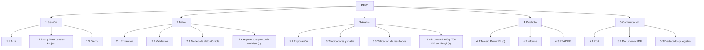
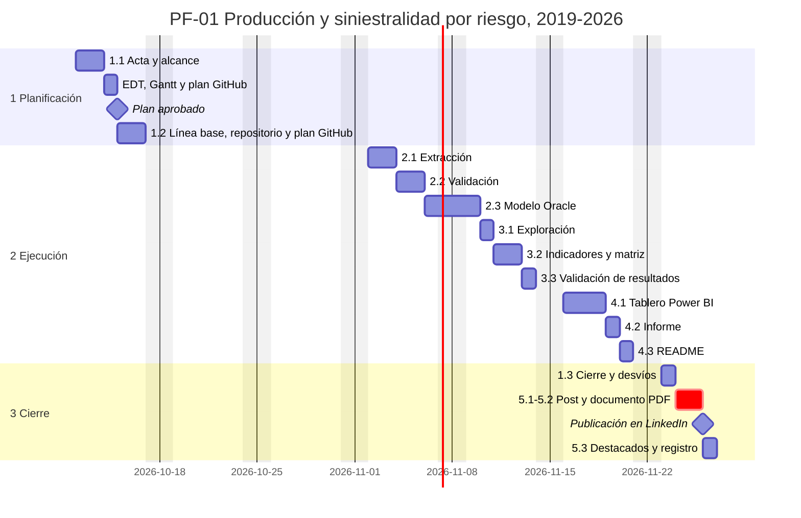

# EDT y Gantt · PF-01: Producción y siniestralidad por riesgo del mercado asegurador peruano, 2019-2026

`Portafolio · PF-01` · Versión 1.4 · 2026-10-11 · Estado: aprobado el 2026-10-11 · Cambio v1.4: se incluyen los paquetes opcionales 2.4 (Visio) y 3.4 (Bizagi) por control de cambios (issue #1), fuera de la línea base v1.0 (sección 4) · Cambio v1.3: nota sobre la Baseline fijada en Microsoft Project y su calendario (sección 3) · Cambio v1.2: el paquete 2.1 se llama «Extracción» (antes «Adquisición»), a pedido del director del proyecto; no cambian el alcance, las fechas ni las horas

La línea base formal es la Baseline del cronograma de Microsoft Project en `gestion/cronograma/PF-01_cronograma.mpp`. El Gantt de este archivo es su vista resumida y queda congelado como línea base v1.0 cuando se aprueba el plan.

## 1. Estructura de desglose del trabajo

Los paquetes marcados con (o) son opcionales. Los paquetes 2.4 (arquitectura en Visio) y 3.4 (proceso en Bizagi) se excluyeron en la línea base y se incluyeron el 2026-10-11 por control de cambios (sección 4).

*Nota.* Elaboración propia.

## 2. Diccionario de la EDT

| Código | Paquete | Entregable | Criterio de aceptación | Etiqueta | Prioridad | Milestone | Inicio | Fin | Núcleo u opcional | Estimación (h) |
|---|---|---|---|---|---|---|---|---|---|---|
| 1.1 | Acta | `docs/01_acta.md` | Aprobada por José | tipo:gestion | alta | PF-01 · 1 Planificación | 2026-10-12 | 2026-10-13 | Núcleo | 1.0 |
| 1.2 | Plan y línea base en Project | `docs/02_edt_gantt.md`, `gestion/cronograma/PF-01_cronograma.mpp` con Baseline, XML y PDF; repositorio y plan GitHub creados | «Plan aprobado»; Baseline fijada con la skill `portafolio-ms-project` | tipo:gestion | alta | PF-01 · 1 Planificación | 2026-10-15 | 2026-10-16 | Núcleo | 1.5 |
| 2.1 | Extracción | `scripts/descargar_sbs.py`, `data/raw/manifest.csv` y tablas en formato largo en `data/interim/` | Descarga los 9 boletines mensuales S-367 (ZIP) y los cuadros S-401, S-402 y S-403 de agosto de 2026, con pausa y reintentos; registra URL, fecha y SHA-256; lleva P001 a P004 (con moneda MN, ME y total) y P009 a P016 a formato largo sin pasos manuales | tipo:datos | alta | PF-01 · 2 Ejecución | 2026-11-02 | 2026-11-03 | Núcleo | 4.5 |
| 2.2 | Validación | Pruebas de datos en `tests/`; tabla de equivalencias de empresas; catálogo de riesgos por corte | Cuadre del 100 % de los totales con la columna Total (tolerancia: 1 mil soles); Activo = Pasivo + Patrimonio por empresa; P009 a P016 iguales a S-401, S-402 y S-403 de agosto de 2026; estructura validada por corte; versión del plan de cuentas registrada; cifras acumuladas confirmadas | tipo:datos | alta | PF-01 · 2 Ejecución | 2026-11-04 | 2026-11-05 | Núcleo | 2.5 |
| 2.3 | Modelo de datos Oracle | `docker-compose.yml` con `gvenzl/oracle-free:23.26.3` en `127.0.0.1:1522`; DDL y vistas en `sql/oracle/` para estados financieros, indicadores y producción y siniestralidad; carga con python-oracledb; `docs/03_diccionario_datos.md` | Scripts idempotentes; la base se reconstruye desde cero; O1 cumplido | tipo:datos | alta | PF-01 · 2 Ejecución | 2026-11-06 | 2026-11-09 | Núcleo | 3.5 |
| 2.4 | Arquitectura y modelo de datos en Visio | `docs/diagramas/`: `.vsdx`, SVG por página y PDF | Arquitectura del flujo de datos y modelo Oracle en pata de gallo; SVG en `docs/04_arquitectura.md` y el README como figura APA; skill `portafolio-visio` | tipo:datos | media | PF-01 · 2 Ejecución | 2026-10-16 | 2026-10-16 | Opcional (cambio del 2026-10-11) | 2.0 |
| 3.1 | Exploración | `notebooks/01-jc-exploracion.ipynb` | Hallazgos y casos atípicos documentados | tipo:analisis | media | PF-01 · 2 Ejecución | 2026-11-10 | 2026-11-10 | Núcleo | 1.0 |
| 3.2 | Indicadores y matriz | Código en `src/`; vistas `vw_` de crecimiento y siniestralidad | Crecimiento interanual (agosto de 2026 frente a agosto de 2025), TCAC 2019-2025, siniestralidad directa y retenida, umbral de S/ 5 millones y cuadrantes; pruebas en verde | tipo:analisis | alta | PF-01 · 2 Ejecución | 2026-11-11 | 2026-11-12 | Núcleo | 2.0 |
| 3.3 | Validación de resultados | Nota de validación en `reports/` | La siniestralidad total replica la hoja P015 (S-403) con una diferencia no mayor de 0.1 p. p.; O2 cumplido | tipo:analisis | alta | PF-01 · 2 Ejecución | 2026-11-13 | 2026-11-13 | Núcleo | 1.0 |
| 3.4 | Proceso AS-IS y TO-BE en Bizagi | `docs/procesos/`: `.bpm`, `.bpmn`, SVG AS-IS y TO-BE y PDF | BPMN 2.0 validado en Bizagi Modeler; SVG en el README como figura APA; skill `portafolio-bizagi` | tipo:analisis | media | PF-01 · 2 Ejecución | 2026-10-22 | 2026-10-22 | Opcional (cambio del 2026-10-11) | 2.0 |
| 4.1 | Tablero Power BI | PBIP (TMDL y PBIR) en `dashboards/powerbi/` | Capturas en `reports/figures/` con nota APA; `.gitignore` con las exclusiones de PBIP | tipo:producto | media | PF-01 · 2 Ejecución | 2026-11-16 | 2026-11-18 | Opcional | 4.0 |
| 4.2 | Informe | `reports/informe.md` | Citas, figuras, tablas y referencias en APA 7; ortografía RAE | tipo:producto | alta | PF-01 · 2 Ejecución | 2026-11-19 | 2026-11-19 | Núcleo | 1.5 |
| 4.3 | README | `README.md` (03f) | Reproducción probada desde un clon limpio | tipo:producto | alta | PF-01 · 2 Ejecución | 2026-11-20 | 2026-11-20 | Núcleo | 1.0 |
| 1.3 | Cierre | `docs/05_cierre_lecciones.md` (03e); `PF-01_seguimiento.pdf` y `PF-01_desvios.csv` | Criterios de cierre cumplidos; desvíos explicados | tipo:gestion | media | PF-01 · 3 Cierre | 2026-11-23 | 2026-11-23 | Núcleo | 1.0 |
| 5.1 | Post | `linkedin/post.md` | Checklist de 08 y skill `revision-anti-estilo-ia` | tipo:comunicacion | alta | PF-01 · 3 Cierre | 2026-11-24 | 2026-11-25 | Núcleo | 0.5 |
| 5.2 | Documento PDF | `linkedin/documento.pdf` (6 a 8 páginas, 1080 × 1350) | `scripts/verificar_pdf.py` sin errores; checklist de la skill de marca | tipo:comunicacion | alta | PF-01 · 3 Cierre | 2026-11-24 | 2026-11-25 | Núcleo | 1.5 |
| 5.3 | Destacados y registro | URL del post en 06 y en el tablero | Corte Cierre registrado | tipo:comunicacion | media | PF-01 · 3 Cierre | 2026-11-26 | 2026-11-26 | Núcleo | 0.5 |
| | | | | | | | | | **Total del núcleo** | **23.0** |
| | | | | | | | | | **Total de opcionales** | **8.0** |

**Control de capacidad:** el núcleo suma 23 h, dentro del rango de 20 a 30 h de 03b. Las 2.5 h de planificación caen en octubre; en noviembre quedan 20.5 h de núcleo y 4 h opcionales, en total 24.5 h frente a las 20 a 25 h disponibles (margen: 0.5 h). La inclusión del Boletín Mensual (v1.1) sumó 2 h a los paquetes de datos; la primera semana concentra hasta 2.5 h por día hábil. Si el tablero se cae, sus 3 días hábiles pasan a ser holgura antes del cierre. Actualización del 2026-10-11: la ejecución empezó tres semanas antes de la línea base y la mayor parte del trabajo cae en octubre, por lo que el límite de capacidad de noviembre deja de ser restrictivo; con 2.4 y 3.4, el total es de 31 h (23 h de núcleo y 8 h opcionales).

## 3. Línea base v1.0 · aprobada el 2026-10-11

El plan se aprobó el 2026-10-11, tres días hábiles antes del hito previsto (2026-10-15); la diferencia se registra como avance real en Project y no modifica esta línea base.

La Baseline se fijó en Microsoft Project el 2026-10-11 (`gestion/cronograma/`: `.mpp`, XML y `PF-01_linea_base.pdf`). El calendario del archivo trabaja de lunes a viernes de 09:00 a 13:00 y de 14:00 a 18:00, e incluye una excepción laborable el 10 y el 11 de octubre de 2026 (de 09:00 a 13:00 y de 14:00 a 18:00) para registrar el trabajo de planificación hecho en fin de semana.

*Nota.* Elaboración propia. Las mismas tareas, duraciones y feriados se cargan en Microsoft Project, para que este Gantt y la Baseline coincidan.

## 4. Cambios aprobados después de la línea base

| Fecha | Cambio | Efecto | Registro |
|---|---|---|---|
| 2026-10-11 | Se incluyen 2.4 Arquitectura y modelo de datos en Visio (#24) y 3.4 Proceso AS-IS y TO-BE en Bizagi (#25), 2 h cada uno | Opcionales de 4.0 a 8.0 h; núcleo sin cambios (23.0 h). 2.4 sigue a 2.3 y 3.4 sigue a 3.3; ninguno es predecesor del núcleo, por lo que no mueven la publicación | Control de cambios en el issue #1 |

Las fechas de 2.4 y 3.4 son las previstas con el avance real del 2026-10-11 (2.1 terminada tres semanas antes de la línea base). En Project se agregan como tareas nuevas y el plan replanificado se guarda en Baseline1 (skill `portafolio-ms-project`, sección B.2); Baseline, la línea base v1.0, no se sobrescribe, y el Gantt de la sección 3 queda congelado como su vista resumida.

## 5. Hitos y milestones de GitHub

| Hito | Fecha | Milestone |
|---|---|---|
| Plan aprobado | 2026-10-15 | PF-01 · 1 Planificación (vence el 2026-10-16, al terminar 1.2) |
| Fin de la ejecución | 2026-11-20 | PF-01 · 2 Ejecución |
| Publicación | 2026-11-26, 08:00 | PF-01 · 3 Cierre |

## 6. Iteraciones del GitHub Project

| Iteración | Semana | Paquetes |
|---|---|---|
| — | 2026-10-12 a 2026-10-16 | 1.1 y 1.2 (fuera del campo Iteración, que empieza el 2026-11-02) |
| S01 | 2026-11-02 a 2026-11-08 | 2.1, 2.2 y 2.3 (inicio) |
| S02 | 2026-11-09 a 2026-11-15 | 2.3 (fin), 3.1, 3.2 y 3.3 |
| S03 | 2026-11-16 a 2026-11-22 | 4.1, 4.2 y 4.3 |
| S04 | 2026-11-23 a 2026-11-29 | 1.3, 5.1, 5.2 y 5.3 |
