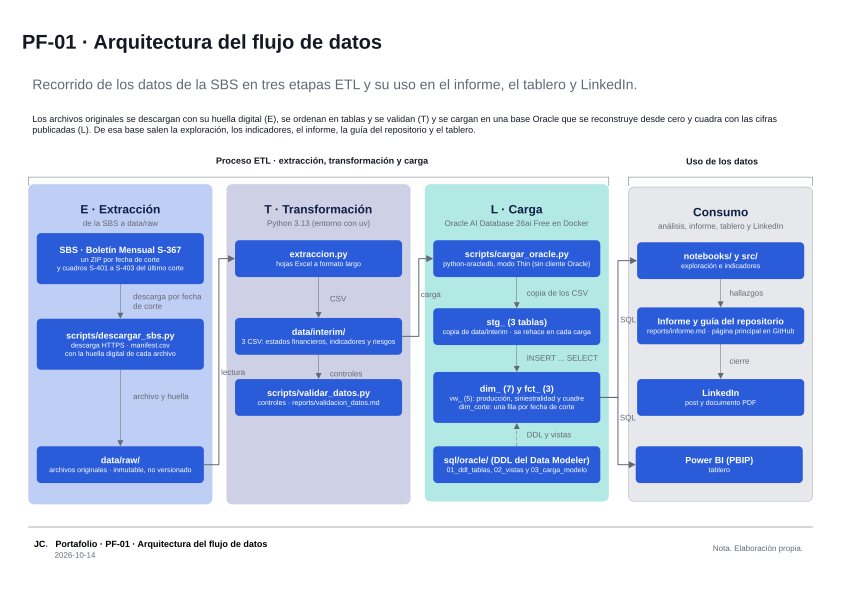
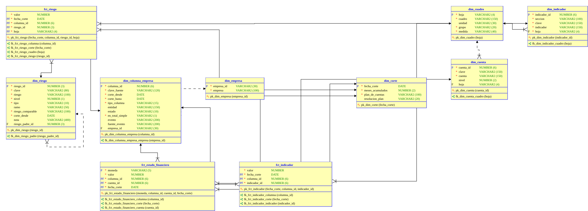

# Arquitectura · PF-01: Producción y siniestralidad por riesgo del mercado asegurador peruano, 2019-2026

`Portafolio · PF-01` · Versión 1.1 · 2026-10-27 · Paquetes 2.4 (issue #24) y 4.5 (issue #57) · Cambio v1.1: 12 vistas, tablero sobre los CSV versionados, serie mensual de 4.4, versión mínima de Oracle y fuente del modelo (auditoría integral, CC-PF-01-02)

Este documento describe el recorrido de los datos del proyecto, desde los archivos que publica la Superintendencia de Banca, Seguros y AFP (SBS) hasta los productos que los consumen (sección 1.4), y presenta el modelo relacional sobre el que se calculan los indicadores. La figura 1 se dibujó en Microsoft Visio Professional 2021 a partir del boceto aprobado el 2026-10-14 y se actualizó el 2026-10-29; la figura 2 la genera Oracle SQL Developer Data Modeler desde el mismo diseño que produjo el DDL de `sql/oracle/`.

## 1. Flujo de datos

**Figura 1**

*Arquitectura del flujo de datos de PF-01*

*Nota.* Elaboración propia. Archivo fuente: `diagramas/PF-01_diagramas.vsdx`; versión PDF en `diagramas/PF-01_diagramas.pdf`. Versión 1.1 del 2026-10-29: doce vistas `vw_`, `scripts/exportar_indicadores.py` como origen de los CSV de `data/processed/`, el informe y el tablero sobre esos CSV (D-PF01-23) y la serie mensual de 4.4 (CC-PF-01-02).

El flujo se organiza en tres etapas ETL y una de consumo. Cada caja de la figura nombra el archivo, la carpeta o el objeto real del repositorio.

### 1.1 E · Extracción: de la SBS a `data/raw/`

`scripts/descargar_sbs.py` descarga por HTTPS el Boletín Mensual S-367 de los 9 cortes del proyecto (un ZIP por fecha de corte) y los cuadros S-401, S-402 y S-403 de agosto de 2026, publicados por la SBS (Superintendencia de Banca, Seguros y AFP [SBS], s. f.). `scripts/descargar_mensual.py` descarga además los cuadros S-401 y S-402 de cada mes de enero de 2025 a agosto de 2026 en `data/raw/mensual/`, con su propio manifiesto (paquete 4.4, CC-PF-01-02). Los archivos se guardan sin modificar en `data/raw/`, carpeta inmutable que no se versiona, y `data/raw/manifest.csv` registra la URL, la fecha de descarga y la huella SHA-256 de cada archivo, de modo que un reemplazo posterior en el servidor de la SBS queda detectado (riesgo R3 del acta).

### 1.2 T · Transformación: Python 3.13 con uv

`src/pf_01_siniestralidad_sbs/extraccion.py` lee las hojas P001 a P004 y P009 a P016 de cada libro Excel y las lleva a formato largo (una fila por corte, empresa, rubro o riesgo y valor). El resultado son tres CSV en `data/interim/`: estados financieros, indicadores y riesgos. En `src/pf_01_siniestralidad_sbs/catalogos/`, el catálogo de empresas resuelve los cambios de razón social y el de riesgos, su jerarquía; el de cortes asigna a cada fecha la versión vigente del plan de cuentas, y el de excepciones documenta las particularidades conocidas de la fuente. `scripts/validar_datos.py` aplica los controles de cuadre y de estructura y escribe su resultado en `reports/validacion_datos.md`.

### 1.3 L · Carga: Oracle AI Database 26ai Free en Docker

`scripts/cargar_oracle.py` se conecta con python-oracledb en modo Thin, sin cliente Oracle instalado, y copia los tres CSV en las tablas `stg_` (3), que se rehacen en cada carga. `sql/oracle/03_carga_modelo.sql` puebla con `INSERT ... SELECT` las dimensiones `dim_` (7) y las tablas de hechos `fct_` (3); `01_ddl_tablas.sql` crea las tablas de forma idempotente `02_vistas.sql` define cinco vistas `vw_` (producción y siniestralidad por riesgo, y tres vistas de cuadre: balance, totales y cuadros S-401 a S-403) y `04_vistas_analisis.sql`, siete vistas del análisis (parámetros, cortes, base por riesgo comparable, indicadores, crecimiento, matriz y participación por empresa): doce vistas en total. La tabla `dim_corte` lleva una fila por fecha de corte con la versión del plan de cuentas vigente.

La base de referencia es el contenedor `gvenzl/oracle-free:23.26.3` (Oracle AI Database 26ai Free), publicado solo en `127.0.0.1:1522` por `docker-compose.yml` (Oracle, s. f.; Venzl, s. f.); es el entorno que cualquier lector puede reproducir. Durante el desarrollo, los mismos scripts se ejecutan por defecto en la instalación nativa de Oracle Database 23ai Free (versión 23.6) del equipo de trabajo, en `localhost:1521/FREEPDB1` (decisión D-PF01-03); el parámetro `--base contenedor` de `scripts/cargar_oracle.py` y de `scripts/ejecutar_sql.py` apunta al contenedor, cuyo DSN se lee de `.env`. La figura muestra solo el contenedor porque es el entorno reproducible del proyecto.

Versión mínima: Oracle Database 23ai. El DDL usa el tipo `BOOLEAN` y `CREATE TABLE IF NOT EXISTS`, que no existen en Oracle Database 19c; se verificó en 23ai Free (23.6) y en 26ai Free (23.26.3).

### 1.4 Consumo: análisis, informe, tablero y LinkedIn

El notebook de exploración (`notebooks/`, paquete 3.1) y `scripts/exportar_indicadores.py` (paquete 3.2) leen las vistas `vw_` por SQL; el segundo escribe los CSV versionados de `data/processed/`. El informe (`reports/informe.md`), sus figuras, el README y el tablero Power BI en formato PBIP (`dashboards/powerbi/`, paquete 4.1) leen esos CSV y no la base (decisión D-PF01-23), de modo que se abren desde un clon limpio sin Oracle. La serie mensual de 4.4 (`data/processed/serie_mensual_riesgos.csv`) se arma en Python desde los cuadros mensuales, sin pasar por Oracle. Del informe y el README salen el post y el documento PDF de LinkedIn (paquetes 5.1 y 5.2).

## 2. Modelo relacional

**Figura 2**

*Modelo relacional de PF-01 en notación pata de gallo*

*Nota.* Elaboración propia con Oracle SQL Developer Data Modeler; diseño en `modelo/pf01_modelo.dmd`, versión PDF en `diagramas/pf01_modelo_relacional.pdf`.

El diagrama muestra las diez tablas del modelo: las dimensiones `dim_columna_empresa`, `dim_corte`, `dim_cuadro`, `dim_cuenta`, `dim_empresa`, `dim_indicador` y `dim_riesgo`, y las tablas de hechos `fct_estado_financiero`, `fct_indicador` y `fct_riesgo`. Las tres tablas `stg_` no forman parte del diseño: son copias de trabajo de los CSV y se definen solo en `sql/oracle/01_ddl_tablas.sql`. El modelo lógico (`diagramas/pf01_modelo_logico.svg`), el diccionario de cada tabla y vista y el procedimiento para reconstruir la base están en [`03_diccionario_datos.md`](03_diccionario_datos.md) y en [`modelo/README.md`](modelo/README.md).

## 3. Decisiones de diseño

| ID | Decisión | Efecto en la arquitectura |
|---|---|---|
| D-PF01-03 | Desarrollo en la base nativa 23ai Free; validación final en el contenedor | Los scripts aceptan `--base nativa` (por defecto) o `--base contenedor`; la figura 1 muestra el contenedor como entorno reproducible |
| D-PF01-05 | Nombres en español, en snake_case, con prefijos `stg_`, `dim_`, `fct_` y `vw_` | Las cajas de la etapa L y del consumo se nombran por prefijo y conteo |
| D-PF01-08 | Solo la serie S-367 alimenta `fct_riesgo`; los cuadros S-401 a S-403 sirven de prueba de consistencia | La extracción descarga ambos; la carga usa uno y la vista `vw_cuadre_cuadros_sbs` compara con el otro |
| D-PF01-09 | Una sola página en Visio (arquitectura); el modelo relacional se publica desde el Data Modeler | La figura 2 sale del diseño del Data Modeler. El DDL vigente es `sql/oracle/01_ddl_tablas.sql`, que agrega restricciones CHECK, índices y comentarios que el DDL generado por el Data Modeler (`modelo/ddl_generado_datamodeler.sql`, para 21c) no incluye |
| D-PF01-23 | El informe, sus figuras y el tablero leen CSV versionados de `data/processed/` | El consumo no depende de Oracle; la base valida y calcula, y `exportar_indicadores.py` publica los resultados |
| CC-PF-01-02 | Serie mensual S-401 y S-402 para ubicar el cambio del plan de cuentas de marzo de 2026 | Segundo flujo de extracción, solo en Python, con manifiesto propio en `data/raw/mensual/` |

## Referencias

Oracle. (s. f.). *Get started with Oracle Database 26ai*. Recuperado el 10 de octubre de 2026, de https://www.oracle.com/database/free/get-started/

Superintendencia de Banca, Seguros y AFP. (s. f.). *Boletín mensual* [Conjunto de datos]. Recuperado el 10 de octubre de 2026, de https://www.sbs.gob.pe/app/stats_net/stats/EstadisticaSistemaFinancieroResultados.aspx?c=S-367

Venzl, G. (s. f.). *oci-oracle-free* [Software]. GitHub. Recuperado el 10 de octubre de 2026, de https://github.com/gvenzl/oci-oracle-free
