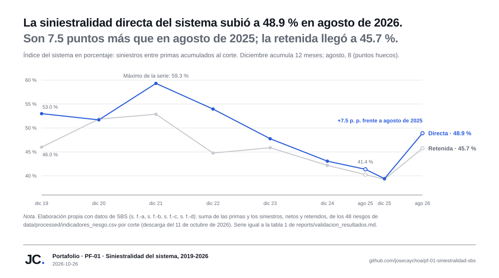
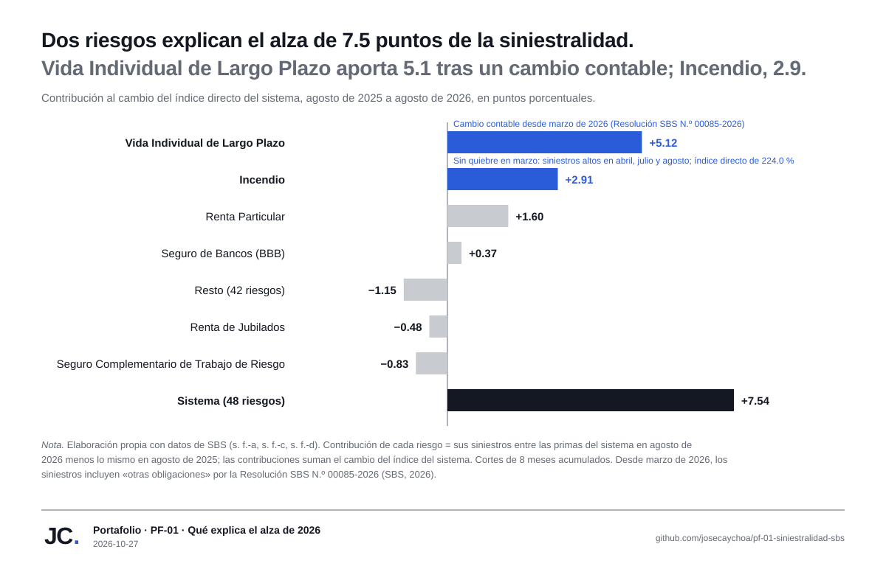
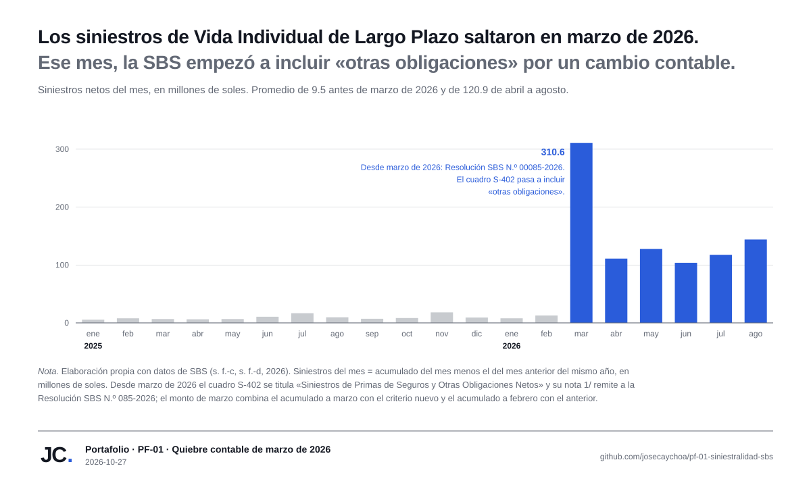
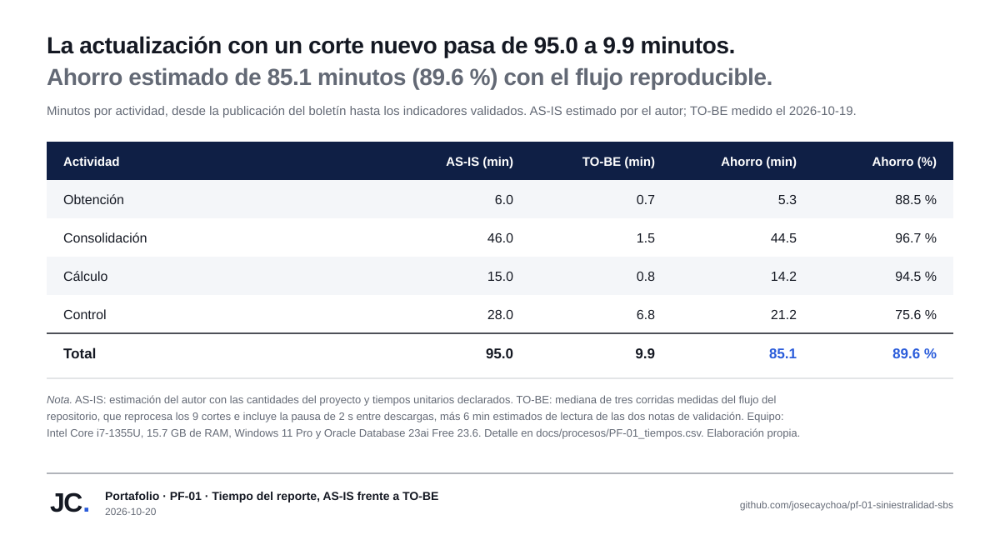

# Informe de resultados · PF-01 · Producción y siniestralidad por riesgo del mercado asegurador peruano, 2019-2026

`Portafolio · PF-01` · Paquetes 4.2 (issue #11) y 4.4 (issue #56) · Corte de datos: agosto de 2026 · Versión 1.1 · Elaborado el 2026-10-26 y actualizado el 2026-10-27

## Resumen

En agosto de 2026, el sistema asegurador peruano acumuló primas netas por 16 784.7 millones de soles, 9.0 % más que en agosto de 2025, con una siniestralidad directa de 48.9 % y una retenida de 45.7 % (Superintendencia de Banca, Seguros y AFP [SBS], s. f.-a). La directa subió 7.5 puntos porcentuales (p. p.) en un año, pero el alza no es generalizada: dos riesgos la explican. Vida Individual de Largo Plazo aporta 5.1 p. p. y su salto coincide con un cambio contable: desde la información de marzo de 2026, la Resolución SBS N.º 00085-2026 estandariza el tratamiento de los rescates y vencimientos de los seguros de vida con componente de ahorro, y el cuadro de siniestros de la SBS pasa a incluir «otras obligaciones» (SBS, 2026). Incendio aporta 2.9 p. p., sin quiebre en marzo, con siniestros altos en abril, julio y agosto. Sin esos dos riesgos, el índice del resto del sistema pasa de 44.7 % a 45.0 %. De los 35 riesgos clasificados en la matriz, 9 crecen con una siniestralidad directa mayor que el corte de 44.0 %.

## 1. Problema y alcance

El proyecto responde una pregunta de monitoreo del mercado: ¿qué riesgos del sistema asegurador peruano crecen en primas con una siniestralidad mayor que la del conjunto, y cómo evolucionó el índice del sistema entre 2019 y 2026? El análisis cubre las primas y los siniestros, netos y retenidos, de los 48 riesgos del Boletín mensual de la SBS (s. f.-a), con un umbral de materialidad de 5 millones de soles de primas netas acumuladas por corte. El alcance describe cifras agregadas por riesgo; excluye juicios sobre la gestión de las empresas y cualquier dato personal (acta, `docs/01_acta.md`, sección 4).

## 2. Datos y método

Los datos provienen de cuatro conjuntos públicos de la SBS: el Boletín mensual (s. f.-a), el índice de siniestralidad por riesgos (s. f.-b), las primas por riesgos (s. f.-c) y los siniestros por riesgos (s. f.-d), descargados el 11 de octubre de 2026 con un script reproducible que registra URL, fecha y SHA-256 de cada archivo (`data/raw/manifest.csv`). Para ubicar en el tiempo el cambio de 2026 se agregan los cuadros mensuales de primas (s. f.-c) y siniestros (s. f.-d) por riesgo de enero de 2025 a agosto de 2026, descargados el 27 de octubre de 2026 con su propio manifiesto (`data/raw/mensual/manifest.csv`); su serie por riesgo (`data/processed/serie_mensual_riesgos.csv`) cuadra con el Boletín mensual en agosto de 2025 y de 2026. El flujo lleva las hojas a formato largo, las carga en Oracle y calcula los indicadores en las vistas `vw_` de `sql/oracle/04_vistas_analisis.sql`; los CSV que alimentan el tablero y este informe están versionados en `data/processed/` (decisión D-PF01-23).

La serie usa el Total ampliado del catálogo de empresas, que incorpora a Rigel y Coface (decisiones D-PF01-12 y D-PF01-18); por esa diferencia de alcance, 5 celdas del índice publicado de diciembre de 2020 se documentan como excepciones de la fuente. La validación de resultados (`reports/validacion_resultados.md`) cuadra el índice del sistema con el publicado en los 9 cortes con una diferencia máxima de 0.0015 p. p., dentro de la tolerancia de 0.1 p. p. del objetivo O2, y cita 27 pruebas automatizadas superadas.

## 3. El sistema, 2019-2026

La siniestralidad directa del sistema pasó de 53.0 % en diciembre de 2019 a un máximo de 59.3 % en diciembre de 2021, bajó en los cuatro cortes anuales siguientes hasta 39.4 % en diciembre de 2025 y repuntó a 48.9 % en agosto de 2026, 7.5 p. p. por encima de agosto de 2025 (tabla 1 y figura 1). La sección 4 muestra qué explica ese repunte. La retenida alcanzó su propio máximo en 2021 (52.9 %), corre por debajo de la directa desde 2022 y cerró agosto de 2026 en 45.7 %, 5.5 p. p. más que un año antes. Las primas netas cayeron 0.7 % en 2020 y crecieron todos los años desde 2021; el acumulado de agosto de 2026 supera en 9.0 % al de agosto de 2025.

**Tabla 1**

*Primas netas e índice de siniestralidad del sistema por corte, 2019-2026*

| Corte | Meses | Primas netas (millones de S/) | Directa (%) | Retenida (%) |
|---|---:|---:|---:|---:|
| 2019-12-31 | 12 | 14 113.5 | 53.0 | 46.0 |
| 2020-12-31 | 12 | 14 021.4 | 51.7 | 51.9 |
| 2021-12-31 | 12 | 17 695.5 | 59.3 | 52.9 |
| 2022-12-31 | 12 | 18 746.3 | 54.0 | 44.8 |
| 2023-12-31 | 12 | 20 265.8 | 47.8 | 45.9 |
| 2024-12-31 | 12 | 22 186.1 | 43.1 | 42.2 |
| 2025-08-31 | 8 | 15 398.0 | 41.4 | 40.3 |
| 2025-12-31 | 12 | 24 034.6 | 39.4 | 39.3 |
| 2026-08-31 | 8 | 16 784.7 | 48.9 | 45.7 |

*Nota.* Elaboración propia con datos de SBS (s. f.-a, s. f.-b, s. f.-c, s. f.-d). Suma de los 48 riesgos de `data/processed/indicadores_riesgo.csv`; los cortes de diciembre acumulan 12 meses y los de agosto, 8. Detalle con cuatro decimales en `reports/validacion_resultados.md`, tabla 1. La tabla se genera con `uv run python scripts/figura_serie.py --tabla`.

**Figura 1**

*Índice de siniestralidad del sistema asegurador peruano por corte, 2019-2026*

*Nota.* Elaboración propia con datos de SBS (s. f.-a, s. f.-b, s. f.-c, s. f.-d). Figura generada con `uv run python scripts/figura_serie.py`; los puntos huecos marcan los cortes de agosto (8 meses acumulados).

## 4. Qué explica el alza de 2026

El cambio del índice del sistema entre dos cortes se reparte sin residuo entre los riesgos: la contribución de cada uno es la diferencia entre sus siniestros divididos entre las primas del sistema en agosto de 2026 y lo mismo en agosto de 2025, y la suma de las contribuciones es el cambio del índice (módulo `contribucion.py`, con la prueba de esa suma en `tests/test_contribucion.py`). De los +7.54 p. p. de la directa, Vida Individual de Largo Plazo aporta +5.12 e Incendio, +2.91; los otros 46 riesgos suman −0.49 (tabla 2 y figura 2). En la retenida, que subió +5.50 p. p., Vida Individual de Largo Plazo aporta +6.15.

**Tabla 2**

*Contribución de los riesgos al cambio de la siniestralidad del sistema, agosto de 2025 a agosto de 2026*

| Riesgo | Directa, agosto de 2025 (%) | Directa, agosto de 2026 (%) | Contribución a la directa (p. p.) | Contribución a la retenida (p. p.) |
|---|---:|---:|---:|---:|
| Vida Individual de Largo Plazo | 4.4 | 45.0 | +5.12 | +6.15 |
| Incendio | 76.7 | 224.0 | +2.91 | +0.43 |
| Renta Particular | 20.6 | 27.8 | +1.60 | +1.82 |
| Seguro de Bancos (BBB) | −479.5 | 69.0 | +0.37 | +0.01 |
| Resto (42 riesgos) |  |  | −1.15 | −1.80 |
| Renta de Jubilados | 1 300.7 | 1 853.2 | −0.48 | −0.71 |
| Seguro Complementario de Trabajo de Riesgo | 72.4 | 56.2 | −0.83 | −0.40 |
| **Sistema** | **41.4** | **48.9** | **+7.54** | **+5.50** |

*Nota.* Elaboración propia con datos de SBS (s. f.-a, s. f.-c, s. f.-d). Riesgos con mayor contribución al alza y a la baja de la directa; el resto se agrupa en una fila. El índice propio de los riesgos de rentas (pagos de pensiones frente a primas) y el de Seguro de Bancos (BBB) en agosto de 2025, con siniestros negativos, no son comparables con el resto. Las contribuciones suman el cambio del sistema. La tabla se genera con `uv run python scripts/figura_contribucion.py --tabla`.

**Figura 2**

*Contribución de los riesgos al cambio de la siniestralidad directa del sistema, agosto de 2025 a agosto de 2026*

*Nota.* Elaboración propia con datos de SBS (s. f.-a, s. f.-c, s. f.-d). Figura generada con `uv run python scripts/figura_contribucion.py`.

Los cortes de agosto acumulan 8 meses, así que no muestran en qué mes cambió la serie. Los cuadros mensuales sí lo muestran: los siniestros de Vida Individual de Largo Plazo promediaron 9.5 millones de soles al mes de enero de 2025 a febrero de 2026, saltaron a 310.6 millones en marzo de 2026 y promediaron 120.9 millones de abril a agosto, mientras sus primas mensuales de 2026 se mantuvieron entre 221 y 304 millones, sin un salto equivalente (figura 3). Marzo de 2026 es el mes en que rige la Resolución SBS N.º 00085-2026, que modifica el Plan de Cuentas del sistema asegurador para «estandarizar el tratamiento contable de los rescates y vencimientos en los seguros de vida con componente de ahorro» (SBS, 2026). Desde ese mes, el cuadro de siniestros por riesgo se titula «Siniestros de Primas de Seguros y Otras Obligaciones Netos» y su nota 1/ indica que incorpora los cambios contables de esa resolución (SBS, s. f.-d). El índice propio de Vida Individual de Largo Plazo pasó así de 4.5 % en febrero de 2026 a 46.2 % en marzo, en cifras acumuladas. Por eso, la mayor parte del alza del sistema refleja un cambio en lo que se registra como siniestro y no un deterioro técnico comparable con los años anteriores. El detalle contable está en el Anexo de la resolución, publicado en el portal de la SBS, que no se pudo descargar para este informe; la atribución se apoya en la coincidencia del mes, el título y la nota del cuadro, y el considerando de la norma.

**Figura 3**

*Siniestros mensuales de Vida Individual de Largo Plazo, enero de 2025 a agosto de 2026*

*Nota.* Elaboración propia con datos de SBS (s. f.-c, s. f.-d, 2026). Siniestros del mes calculados como la diferencia entre acumulados consecutivos del mismo año (`data/processed/serie_mensual_riesgos.csv`). Figura generada con `uv run python scripts/figura_contribucion.py`.

Incendio no muestra ese quiebre: sus siniestros mensuales promediaron 35.6 millones de soles de enero de 2025 a febrero de 2026 y llegaron a 136.9 millones en abril, 275.2 millones en julio y 171.8 millones en agosto de 2026. Su índice directo de 224.0 % en agosto de 2026 contrasta con el retenido de 55.4 %: el 89.1 % de los siniestros acumulados del año se cedió en reaseguro.

## 5. Matriz de riesgos de agosto de 2026

La matriz clasifica cada riesgo según dos atributos: la variación interanual de sus primas netas (crece si es mayor o igual que 0 %) y su índice de siniestralidad frente al corte, definido como el índice agregado de los riesgos clasificados: 44.0 % en la directa y 39.5 % en la retenida (indicador IA-PF01-07 del acta). De los 48 riesgos del corte, 35 quedan clasificados, con 11 782.8 millones de soles de primas netas; 8 quedan bajo el umbral de materialidad (8.3 millones en conjunto) y 5 no son comparables por su naturaleza previsional (rentas y seguros del Sistema Privado de Pensiones, 4 993.5 millones).

**Tabla 3**

*Riesgos clasificados por cuadrante, agosto de 2026*

| Cuadrante | Lectura | Directa | Retenida |
|---|---|---:|---:|
| 1 · Crece sobre el corte | Primas en aumento y siniestralidad mayor que el conjunto | 9 | 8 |
| 2 · Crece bajo el corte | Primas en aumento y siniestralidad menor que el conjunto | 12 | 13 |
| 3 · Decrece sobre el corte | Primas en descenso y siniestralidad mayor que el conjunto | 7 | 5 |
| 4 · Decrece bajo el corte | Primas en descenso y siniestralidad menor que el conjunto | 7 | 9 |
| **Total** | | **35** | **35** |

*Nota.* Elaboración propia con datos de SBS (s. f.-a, s. f.-b, s. f.-c, s. f.-d), según `data/processed/matriz_riesgos.csv`. El corte no es una meta: cambia con cada corte de datos (D-PF01-16).

El cuadrante 1 de la directa reúne a los 9 riesgos que crecen con una siniestralidad mayor que el 44.0 % del conjunto (tabla 4). Tres de ellos concentran el 83.7 % de las primas del cuadrante: Vida Individual de Largo Plazo, que creció 31.2 % con un índice de 45.0 % que refleja el cambio contable de marzo de 2026 (sección 4); Asistencia Médica, con 65.7 % de siniestralidad, y Vehículos, con 61.3 %. Con la medida retenida, el grupo baja a 8 riesgos frente a un corte de 39.5 %: Crédito Interno sale del cuadrante porque su índice retenido (28.2 %) queda bajo ese corte.

**Tabla 4**

*Cuadrante 1 con la siniestralidad directa: riesgos que crecen sobre el corte de 44.0 %, agosto de 2026*

| Riesgo | Ramo | Primas netas (millones de S/) | Variación interanual (%) | Directa (%) |
|---|---|---:|---:|---:|
| Vida Individual de Largo Plazo | Vida | 2 081.1 | 31.2 | 45.0 |
| Asistencia Médica | Accidentes y enfermedades | 1 238.9 | 7.6 | 65.7 |
| Vehículos | Generales | 1 117.9 | 3.4 | 61.3 |
| Seguro Obligatorio de Accidentes de Tránsito (SOAT) | Accidentes y enfermedades | 387.9 | 7.6 | 64.8 |
| Vida Ley Trabajadores | Vida | 285.9 | 0.0 | 45.7 |
| Agricola | Generales | 74.7 | 333.0 | 74.3 |
| Todo Riesgo Equipo para Contratistas | Generales | 67.8 | 2.7 | 89.9 |
| Crédito Interno | Generales | 45.8 | 7.8 | 60.8 |
| Escolares | Accidentes y enfermedades | 5.3 | 16.0 | 44.2 |

*Nota.* Elaboración propia con datos de SBS (s. f.-a, s. f.-b, s. f.-c, s. f.-d), según `data/processed/matriz_riesgos.csv`, ordenada por primas netas. Los nombres de los riesgos reproducen el catálogo de la fuente. La variación de Agricola parte de una base pequeña (17.2 millones en agosto de 2025).

Las figuras 4 y 5 muestran la página «Matriz de riesgos» del tablero Power BI del paquete 4.1, que ubica cada riesgo clasificado por su variación interanual y su índice, con la segmentación «Medida» para alternar entre la directa y la retenida (`dashboards/powerbi/README.md`).

**Figura 4**

*Matriz de riesgos con la siniestralidad directa, agosto de 2026*

*Nota.* Elaboración propia con datos de SBS (s. f.-a). Los ejes se recortan en 60 % de variación y 100 % de siniestralidad (D-PF01-13): 3 de los 35 riesgos clasificados quedan fuera de escala y no se dibujan, aunque cuentan en las tablas.

**Figura 5**

*Matriz de riesgos con la siniestralidad retenida, agosto de 2026*

*Nota.* Elaboración propia con datos de SBS (s. f.-a). Misma página que la figura 4, con la medida Retenida; 2 de los 35 riesgos clasificados quedan fuera de escala.

## 6. El proceso: de 95.0 a 9.9 minutos por corte

Reproducir este reporte a mano (descargar los boletines, consolidar las hojas, homologar empresas, alinear riesgos, armar fórmulas y cuadrar totales) toma 95.0 minutos por corte, según la estimación del autor con las cantidades del proyecto. El flujo del repositorio ejecuta las mismas actividades en 9.9 minutos: 3.9 de scripts medidos (mediana de tres corridas que reprocesan los 9 cortes) y 6.0 estimados de lectura de las dos notas de validación. El ahorro es de 85.1 minutos por corte (89.6 %), y el flujo agrega lo que el proceso manual no tenía: manifiesto de descarga, catálogos versionados y 27 pruebas automatizadas (figura 6).

**Figura 6**

*Tiempo del reporte de siniestralidad por corte, AS-IS frente a TO-BE*

*Nota.* Elaboración propia. Medición del 2026-10-19 descrita en `docs/procesos/PF-01_tiempos.csv`; diagramas BPMN del proceso en `docs/procesos/`.

## 7. Limitaciones

- Los cortes de agosto acumulan 8 meses y los de diciembre, 12; el índice no está anualizado, así que las comparaciones interanuales válidas son entre cortes del mismo mes.
- Desde la información de marzo de 2026, los siniestros incluyen «otras obligaciones» por la Resolución SBS N.º 00085-2026 (SBS, 2026): el corte de agosto de 2026 no es comparable con los anteriores en Vida Individual de Largo Plazo, y no se aisló el efecto en otros seguros de vida con componente de ahorro. No se pudo leer el Anexo de la resolución con el detalle de las cuentas.
- La matriz usa un solo corte (agosto de 2026). Para otro corte hay que regenerar los CSV con `uv run python scripts/exportar_indicadores.py`.
- 5 riesgos previsionales (4 993.5 millones de soles de primas) y 8 riesgos bajo el umbral (8.3 millones) quedan fuera de la clasificación por cuadrante.
- En diciembre de 2020, 5 celdas del índice publicado por riesgo difieren del calculado porque la fuente usó el Total simple, sin Rigel ni Coface; la serie usa el Total ampliado en todos los cortes (D-PF01-18).
- Los índices describen montos agregados por riesgo. No miden rentabilidad técnica ni suficiencia de primas, y el alcance excluye juicios sobre la gestión de las empresas.

## 8. Conclusiones

La siniestralidad directa del sistema llegó a 48.9 % en agosto de 2026, 7.5 p. p. más que un año antes, con primas que crecieron 9.0 %. Esa alza no es un deterioro generalizado. Vida Individual de Largo Plazo explica 5.1 p. p., y su salto coincide con el mes en que rige la Resolución SBS N.º 00085-2026, desde el cual los siniestros de la SBS incluyen «otras obligaciones» de los seguros de vida con ahorro; Incendio explica 2.9 p. p. con siniestros elevados desde abril, en su mayor parte cedidos en reaseguro; el resto del sistema pasa de 44.7 % a 45.0 %. Para leer el índice de 2026 hay que separar el efecto contable del técnico: compararlo con los años anteriores sin ese ajuste sobrestima el deterioro. La matriz de cuadrantes ubica a los 9 riesgos que crecen con una siniestralidad mayor que la del conjunto, y el flujo reproducible regenera estos resultados desde la descarga.

## Referencias

Superintendencia de Banca, Seguros y AFP. (s. f.-a). *Boletín mensual* [Conjunto de datos]. Recuperado el 11 de octubre de 2026, de https://www.sbs.gob.pe/app/stats_net/stats/EstadisticaSistemaFinancieroResultados.aspx?c=S-367

Superintendencia de Banca, Seguros y AFP. (s. f.-b). *Índice de siniestralidad directa y retenida según riesgos* [Conjunto de datos]. Recuperado el 11 de octubre de 2026, de https://www.sbs.gob.pe/app/stats_net/stats/EstadisticaSistemaFinancieroResultados.aspx?c=S-403

Superintendencia de Banca, Seguros y AFP. (s. f.-c). *Primas de seguros netas, cedidas y retenidas según riesgos* [Conjunto de datos]. Recuperado el 11 de octubre de 2026, de https://www.sbs.gob.pe/app/stats_net/stats/EstadisticaSistemaFinancieroResultados.aspx?c=S-401

Superintendencia de Banca, Seguros y AFP. (s. f.-d). *Siniestros de primas de seguros netas, cedidas y retenidas según riesgos* [Conjunto de datos]. Recuperado el 11 de octubre de 2026, de https://www.sbs.gob.pe/app/stats_net/stats/EstadisticaSistemaFinancieroResultados.aspx?c=S-402

Superintendencia de Banca, Seguros y AFP. (2026). *Resolución S.B.S. N.º 00085-2026: Modifica el Plan de Cuentas para las Empresas del Sistema Asegurador*. https://intranet2.sbs.gob.pe/dv_int_cn/2551/v1.0/Adjuntos/R.%2000085-2026.pdf
